# FunZone: данные и модель БД (исследование, роль: DB-инженер)

MODE: DESIGN (только планирование, в репозитории ничего не менялось, кроме этого файла).
Версия 2 от 2026-10-06 (учтён ввод владельца). Источники: `DB/gamedatabase.sql`, `BE/**`, `FE/src/data/gamesRegistry.js`, `FE/src/components/GameShell/GameShell.jsx`, `docker-compose.yml`, `.env.example`.

### Что изменилось в v2 (ввод владельца)

| Ввод | Следствие для данных |
|---|---|
| Языковые пары: сначала **RU↔HE**, потом **RU↔EN** | RTL (иврит) с первого дня. Русский — базовый язык UI. В модели нужны грамматические признаки: род (иврит: м/ж, русский: м/ж/ср), формы числительных и плюрала (`1 яблоко / 2 яблока / 5 яблок`, `שלושה תפוחים` / `שלוש בננות`), ударения для русского и никуд для иврита (раздел 2.3, «Языковая специфика RU/HE»). |
| Владелец живёт в Израиле, действует **Закон о защите приватности (поправка 13)** наряду с COPPA и GDPR-K | Регион AWS **il-central-1 (Тель-Авив)** для БД и S3. Журнал доступа персонала к персональным данным (`staff_access_log`). План реагирования на инциденты. Права на доступ и исправление данных. Конкретные обязанности (регистрация базы, DPO, уровень безопасности по Data Security Regulations) уточняет юрист (раздел 3.5). |
| Соавтор не дал согласия на коммерческое использование, поэтому **бэкенд и схема Phase 1 пишутся с нуля**; реальных пользователей нет | **Миграции данных нет.** Нет baseline-миграции, нет скрипта переноса blob → S3, нет expand/contract для старых таблиц. Схема создаётся первой knex-миграцией, ассеты с первого дня лежат в S3. Старый дамп и старый BE не переиспользуются (ни код, ни контент, ни seed). Аудит в разделе 1 остаётся как список уроков: «чего не повторить». |
| 6–8 игр по математике и логике, **контент в данных** | Игра = код-механика (`game_type`) + наборы заданий в БД (`items` + переводы). Каталог маленький, поэтому sync из кода становится тривиальным. Главный объём моделирования переезжает в банк заданий (раздел 2.3, «Банк заданий»). |

---

## 0. Коротко (TL;DR)

1. **v2: переходим на PostgreSQL 17** (раз бэкенд пишется с нуля, единственный довод за MySQL — «уже так» — исчез; обоснование в 2.5). Хостинг: **RDS PostgreSQL `db.t4g.micro`, Single-AZ, gp3 20 ГБ, регион il-central-1** (наличие класса инстанса и версии в регионе проверить при создании). Если владелец хочет остаться на MySQL, годится **MySQL 8.4 LTS** (8.0 уже EOL), модель от этого не меняется. Aurora Serverless v2 не берём: дороже на малой нагрузке, а при auto-pause холодный старт порядка 15 с, для детского UX это плохо.
2. Инструмент миграций: **knex (только migrations + seeds)**, драйвер `pg` с пулом (или `mysql2/promise` при MySQL). Схема с нуля, первая миграция = целевая модель.
3. **Каталог игр:** код определяет *механики* (`game_types`, схема задания, правила уровней), БД хранит *игры, задания и переводы*. Игра без механики в коде невозможна (FK). Таблицу `game_types` при деплое синхронизирует скрипт.
4. **Локализация RU↔HE, затем RU↔EN:** UI-строки лежат в i18n JSON (ICU) в репозитории. Учебный контент — в БД: языконезависимые `items` и `concepts` плюс `*_translations` на каждый язык. Тексты задач пишутся в ICU MessageFormat (плюралы RU, род числительных HE); у слов есть `text_marked` (ударения и никуд), кириллическая транслитерация иврита, `gender` и `forms`. Аудио и картинки лежат в S3 через `assets`.
5. **Дети:** `child_profiles` (nickname из генератора, avatar из фиксированного набора, `age_band` вместо даты рождения) принадлежат родителю. ID имеют тип UUIDv7 `BINARY(16)`. Согласия ведём в append-only `consent_events`.
6. **Гостевой режим local-first:** прогресс гостя хранится только на устройстве (IndexedDB). Сервер ничего не знает о ребёнке до согласия родителя. «Claim» означает идемпотентную загрузку локального журнала в профиль ребёнка.
7. **Прогресс:** `game_sessions` → `answer_events` (по строке на каждый ответ). Производные таблицы `child_skill_state`, `child_concept_state` и `child_game_progress` пересчитываются из сырых событий.
8. **Аналитика:** только своя, first-party, без сторонних трекеров в детской зоне. Сырые события живут 13 месяцев, потом остаются агрегаты без child_id. Для портфолио есть генератор синтетических данных.
9. **Старый бэкенд:** эндпоинты `/api/user/:id` (GET/PUT/DELETE) и `PUT /api/page-content` **открыты без авторизации** (раздел 1.4). Раз бэкенд пишется заново, чинить старый код не нужно. Но **старый BE нельзя нигде разворачивать публично**, а в новом каждый маршрут по умолчанию закрыт (deny-by-default), и это проверяется тестами.
10. **Контент в данных:** 6–8 игр — это механики в коде; задания, слова и тексты задач лежат в БД (`items`, `item_translations`, `concepts`) с ICU-шаблонами для склонений и рода.

---

## 1. Аудит текущей схемы и запросов

> v2: бэкенд и схема переписываются с нуля, поэтому колонку «Что делать» ниже читайте как **требование к новому коду**, а не как задачу по правке старого. Ссылки на файлы указывают на старый код.

### 1.1 Схема (`DB/gamedatabase.sql`)

| # | Где | Проблема | Серьёзность | Что делать |
|---|-----|----------|-------------|------------|
| S1 | `gamedatabase.sql:7` | Дамп сделан в phpMyAdmin из **MariaDB 10.4**, а запускается на `mysql:8.0` (`docker-compose.yml:29`). Сейчас всё работает, но схема нигде не версионируется: это снимок, а не миграции. | средняя | Baseline-миграция в knex, дамп убрать из init. |
| S2 | `docker-compose.yml:37` | Дамп монтируется в `docker-entrypoint-initdb.d`, то есть применяется **только на пустом volume**. Любое изменение схемы на существующем volume молча не применится. | высокая (для процесса) | Отдельный сервис `migrate` (`knex migrate:latest`). |
| S3 | `:30-36` | `games.image LONGBLOB NOT NULL`: картинки лежат в строках таблицы. Дамп весит 2,5 МБ почти целиком из-за 7 картинок. Нет `created_at/updated_at`, `ageRating INT` без CHECK, camelCase в имени колонки. | высокая | Перенести картинки в S3 (раздел 3.3), колонку удалить на шаге contract. |
| S4 | `:43-55` | Картинки разных форматов: есть PNG (`0x89504e47…`) и GIF (`0x47494638…`), а отдаются всегда как `image/jpeg` (см. A9). id идут 1–6 и 8 (дырка, это нормально). | низкая | Определять MIME по magic bytes при миграции. |
| S5 | `:63-69` | `page_content.section` **без UNIQUE**, хотя код делает upsert по section (`pageContent.js:27-44`), так что возможны дубли. `active TINYINT(1)` допускает NULL. В `content` лежит сырой HTML. Языка нет. | средняя | `UNIQUE(section, language_code)`, `active NOT NULL`, upsert через `INSERT … ON DUPLICATE KEY UPDATE`. |
| S6 | `:85-91` | `users.role INT NULL`: магические числа, NULL и 0 перемешаны (`:98-111`). У `username` **нет UNIQUE**, хотя регистрация проверяет уникальность. Нет `created_at`, `email_verified_at`, `deleted_at`. | средняя | `role ENUM(...) NOT NULL DEFAULT 'parent'`, временные метки. `username` уходит (у родителя логин по email). |
| S7 | `:120-156` | PK и AUTO_INCREMENT есть у всех трёх таблиц. FK нет (связей пока нет), CHECK нет, вторичных индексов нет, кроме `UNIQUE(email)`. | низкая | В новой модели FK и CHECK обязательны. |
| S8 | `:36,69,91` | Коллация `utf8mb4_general_ci`. Для мультиязычного контента нужна `utf8mb4_0900_ai_ci` по умолчанию и accent-sensitive коллация там, где диакритика значима (`año` ≠ `ano`, огласовки в иврите). | средняя | Задать в baseline-миграции. |

### 1.2 Seed-данные и создание админов

- `gamedatabase.sql:98-108`: у 11 тестовых пользователей **один и тот же bcrypt-хэш**. Если пароль известен, любой, кто поднял дамп, входит под любым из них.
- `gamedatabase.sql:108-110`: адреса похожи на **реальные личные email** (среди них, судя по всему, адрес владельца). Это PII в публичном репозитории. Их надо заменить на `@example.test` и **переписать историю git или хотя бы не тиражировать дамп дальше**. Решение за владельцем.
- `gamedatabase.sql:109`: единственный админ задан строкой `role = 1` прямо в дампе. Других способов создать админа нет: `/register` жёстко пишет `role = 0` (`BE/routes/user.js:73`). Значит, админ появляется только ручным SQL или через дамп.
- **Предложение:** dev-seeds (knex) генерируют фейковых родителей и детей. Админ создаётся CLI-скриптом `npm run admin:create -- --email …`, пароль вводится интерактивно или читается из env, в репозиторий не попадает. В production seeds не запускаются вообще.

### 1.3 SQL-инъекции и корректность запросов

**SQL-инъекций не нашёл:** все запросы параметризованы (`?`). Динамический WHERE в `user.js:295-307` собирается только из констант, значения передаются параметрами, так что он безопасен.

Ошибки корректности:

| # | Где | Проблема |
|---|-----|----------|
| A1 | `user.js:45-74` | Check-then-insert без транзакции и без UNIQUE на username: гонка даёт дубли username. Дубль email упадёт на `UNIQUE(email)` с `ER_DUP_ENTRY`, и пользователь получит **500 вместо 409**. Правильно так: UNIQUE в БД, обработка `ER_DUP_ENTRY` → 409, предварительный SELECT не нужен. |
| A2 | `user.js:24`, `:213` | `^[a-zA-Z]{2,}$`: имя только латиницей. Для мультиязычного продукта это не годится (иврит, кириллица, арабский). |
| A3 | `user.js:38`, `:231` | Пароль 3–8 символов, **максимум 8**, только alnum. Это слабая политика. Нужно минимум 10–12, без верхней границы до 72 байт (лимит bcrypt). |
| A4 | `user.js:140-148` | Роль зашита в JWT на 24 часа: снятие админских прав не действует до истечения токена. Токен хранится в `localStorage` (`AuthContext.jsx:53`). |
| A5 | `games.js:56-69` | `GET /api/games` делает `SELECT *` и отдаёт **все картинки в base64** (+33 % к объёму) одним ответом. |
| A6 | `games.js:103-110`, `:137-152` | `ageRating` не валидируется. В PUT нет проверки `title/content`: NULL в NOT NULL даёт 500. |
| A7 | `pageContent.js:27-44` | Upsert через SELECT → UPDATE/INSERT без UNIQUE и без транзакции (см. S5). |
| A8 | `games.js:60,79,117,131,156,176,196`, `user.js:173,192,249,273` | Клиенту возвращается `err.message`, а значит утекают детали SQL и схемы. |
| A9 | `games.js:204`, `FE/.../GameManagement.jsx:257`, `FE/.../SingleGame.jsx:44` | MIME всегда `image/jpeg`, хотя разрешены PNG и GIF (`games.js:19`). |
| A10 | `FE/src/services/pageContentService.js:7` | Захардкожен `http://localhost:3000`. Сервис нигде в компонентах не используется (мёртвый код). |

### 1.4 Авторизация (это вопрос безопасности данных, поэтому он здесь)

| # | Где | Проблема | Серьёзность |
|---|-----|----------|-------------|
| Z1 | `user.js:187` | `GET /api/user` без `verifyToken` отдаёт **список всех email** любому анониму. | критическая |
| Z2 | `user.js:200` | `PUT /api/user/:id` без авторизации: **кто угодно меняет email и пароль любого пользователя**, включая админа. Это захват аккаунта. | критическая |
| Z3 | `user.js:267` | `DELETE /api/user/:id` без авторизации: кто угодно удаляет кого угодно. | критическая |
| Z4 | `user.js:167` | `GET /api/user/:id` без авторизации, последовательные id (IDOR и перебор). | высокая |
| Z5 | `pageContent.js:21` | `PUT /api/page-content/:section` без авторизации, а в `content` хранится HTML (stored XSS, как только его начнут рендерить). | высокая |
| Z6 | `user.js:285` | `POST /check` позволяет перечислять email без rate-limit. Логин тоже без rate-limit. | средняя |
| Z7 | `auth.js:26` | `role !== 1`: при переходе на ENUM нужно синхронно поменять проверку (`'admin'`). | заметка |

> v2: старый BE не разворачиваем. В новом: глобальный `requireAuth` и явный `public` только для whitelisted маршрутов; проверка владения (`child.owner_user_id = req.user.id`) в одном месте (repository-слой); тест «каждый маршрут без токена → 401» генерируется из таблицы маршрутов.

### 1.5 Подключение к БД (`BE/database/dbSingleton.js`)

- `:8`: `mysql.createConnection`, **одно соединение на весь процесс**, а не пул. Все запросы сериализуются через него.
- Нет обработчика `connection.on('error')`. При `PROTOCOL_CONNECTION_LOST` (idle `wait_timeout`, failover или перезагрузка RDS, maintenance window) соединение умирает навсегда, а необработанное событие `error` **роняет процесс**.
- `:16-22`: `throw err` внутри асинхронного callback даёт uncaught exception, процесс падает без внятного сообщения.
- `user.js:9`, `games.js:4`: соединение создаётся при `require`, то есть на импорте модуля. Это мешает тестам и не даёт сделать graceful shutdown.
- Стиль смешанный: callback в `user.js`/`games.js`, `connection.promise()` в `pageContent.js:8`. Callback-вложенность уже привела к `try/catch`, который не ловит ошибки внутри callback (`user.js:46-93`).
- Не заданы `charset: 'utf8mb4'`, `timezone: 'Z'`, `dateStrings`/`supportBigNumbers`.
- `docker-compose.yml:18` против `:33`: **несовпадение паролей**. Если `DB_PASSWORD` не задан, API подключается с пустым паролем, а MySQL создаётся с `rootpass`, и API не подключится. API ходит под **root** (`:17`). Порт 3306 опубликован на хост (`:39`).

**Целевой вариант** (для PostgreSQL то же самое на `pg.Pool` с `max`, `idleTimeoutMillis`, обработчиком `pool.on('error')` и `SET TIME ZONE 'UTC'`):

```js
// BE/database/pool.js
const mysql = require('mysql2/promise');
const pool = mysql.createPool({
  host, port, user, password, database,
  connectionLimit: Number(process.env.DB_POOL_SIZE || 10),
  waitForConnections: true,
  enableKeepAlive: true,
  charset: 'utf8mb4',
  timezone: 'Z',
  supportBigNumbers: true,
});
module.exports = { pool, query: (sql, p) => pool.execute(sql, p).then(([rows]) => rows) };
// транзакции: const conn = await pool.getConnection(); await conn.beginTransaction(); … finally conn.release()
```

Два пользователя БД: `funzone_app` (DML на свои таблицы) и `funzone_migrator` (DDL). Root только для администрирования.

---

## 2. Целевая модель данных

### 2.1 Принципы

- **Идентификаторы.** Справочники используют естественные ключи (`languages.code`) или `INT AUTO_INCREMENT` с уникальным строковым `key`. Взрослые аккаунты `BIGINT UNSIGNED`, но наружу отдаём только `/me`, id в URL не светим. **Дети, сессии и всё офлайн-генерируемое используют UUIDv7 в `BINARY(16)`**: значения генерируются на клиенте (идемпотентная загрузка из офлайна и из гостевого режима), не перечисляются, упорядочены по времени, поэтому дружат с кластерным индексом InnoDB.
- Время храним как `DATETIME(3)` в UTC. Соединение работает с `timezone 'Z'`. Для «дня» в метриках и серий (streak) используем часовой пояс семьи (`users.time_zone`, по умолчанию `Asia/Jerusalem`): в Израиле неделя начинается в воскресенье, и «день» по UTC сдвинут на 2–3 часа.
- **Резидентность данных:** RDS, S3 и бэкапы в `il-central-1`; CloudFront раздаёт только публичный контент (ассеты, контент-пакеты), персональные данные через CDN не кэшируются.
- Кодировка `utf8mb4` / `utf8mb4_0900_ai_ci`. Для текстов слов используем `utf8mb4_0900_as_cs`: диакритика и регистр значимы. Текст нормализуется в NFC до записи.
- **RTL — это свойство языка, а не данных.** Текст хранится в логическом порядке, направление берётся из `languages.direction`.
- Правила обеспечивает БД: NOT NULL, CHECK, UNIQUE, FK. Для детских данных стоят `ON DELETE CASCADE`, чтобы удаление профиля физически удаляло всё, что к нему относится.
- **Минимизация данных:** у ребёнка нет email, фото, ФИО, даты рождения, свободных текстов (кроме модерируемого nickname) и IP.

### 2.2 ERD

```mermaid
erDiagram
  users ||--o{ child_profiles : owns
  users ||--o{ consent_events : gives
  policy_documents ||--o{ consent_events : "version of"
  child_profiles ||--o{ consent_events : "about (optional)"
  languages ||--o{ child_profiles : "ui / target"

  game_types ||--o{ games : "mechanic (code)"
  games ||--o{ game_translations : has
  games ||--o{ game_language_pairs : "enabled pairs"
  games ||--o{ items : "content"
  items ||--o{ item_translations : "per language"
  skills ||--o{ items : ""
  assets ||--o{ item_translations : audio
  games ||--o{ game_skills : trains
  skills ||--o{ game_skills : ""
  skills ||--o{ skills : parent
  assets ||--o{ games : cover

  concepts ||--o{ concept_translations : "per language"
  languages ||--o{ concept_translations : ""
  assets ||--o{ concept_translations : audio
  assets ||--o{ concepts : image
  concepts }o--o{ items : "referenced in payload"

  child_profiles ||--o{ game_sessions : plays
  games ||--o{ game_sessions : ""
  game_sessions ||--o{ answer_events : contains
  skills ||--o{ answer_events : ""
  items ||--o{ answer_events : ""
  concepts ||--o{ answer_events : "optional"

  child_profiles ||--o{ child_skill_state : ""
  child_profiles ||--o{ child_concept_state : ""
  child_profiles ||--o{ child_game_progress : ""
  child_profiles ||--o{ child_rewards : ""
  reward_definitions ||--o{ child_rewards : ""

  users ||--o{ data_requests : "export/delete/correct"
  users ||--o{ staff_access_log : "staff actions"
```



### 2.3 Таблицы (DDL-эскизы ключевых таблиц)

> Эскизы написаны в синтаксисе MySQL (так были написаны в v1). Модель от СУБД не зависит. При выборе PostgreSQL перевод механический:
>
> | MySQL в эскизе | PostgreSQL |
> |---|---|
> | `BINARY(16)` (UUIDv7) | `uuid` (генерирует приложение; в PG 18 есть `uuidv7()`) |
> | `ENUM(...)` | `text` + `CHECK (x IN (...))` (проще менять миграцией, чем `CREATE TYPE`) |
> | `JSON` | `jsonb` (+ GIN-индекс там, где фильтруем по полям) |
> | `DATETIME(3)` UTC | `timestamptz` |
> | `… AUTO_INCREMENT` | `bigint GENERATED ALWAYS AS IDENTITY` |
> | `ON UPDATE CURRENT_TIMESTAMP` | триггер `set_updated_at()` |
> | `COLLATE utf8mb4_0900_as_cs` | `COLLATE "C"` для точного сравнения; недетерминированная ICU-коллация `und-u-ks-level1` для поиска без диакритики |
> | `BOOL` / `TINYINT(1)` | `boolean` |

#### Аккаунты и роли

```sql
CREATE TABLE users (                      -- взрослые: родители и персонал
  id              BIGINT UNSIGNED AUTO_INCREMENT PRIMARY KEY,
  email           VARCHAR(254) NOT NULL,
  password_hash   VARCHAR(100) NOT NULL,
  role            ENUM('parent','editor','admin') NOT NULL DEFAULT 'parent',
  display_name    VARCHAR(60)  NULL,
  ui_language     VARCHAR(10)  NOT NULL DEFAULT 'en',
  email_verified_at DATETIME(3) NULL,
  last_login_at   DATETIME(3)  NULL,
  token_version   INT UNSIGNED NOT NULL DEFAULT 0,  -- инвалидирует JWT при смене роли/пароля
  time_zone       VARCHAR(40)  NOT NULL DEFAULT 'Asia/Jerusalem',  -- «день» для серий и отчётов
  created_at      DATETIME(3)  NOT NULL DEFAULT CURRENT_TIMESTAMP(3),
  updated_at      DATETIME(3)  NOT NULL DEFAULT CURRENT_TIMESTAMP(3) ON UPDATE CURRENT_TIMESTAMP(3),
  deletion_requested_at DATETIME(3) NULL,
  UNIQUE KEY uq_users_email (email),
  FOREIGN KEY (ui_language) REFERENCES languages(code)
);
```

- `editor` — редактор контента и переводов без доступа к пользователям. Это реальная потребность мультиязычного продукта: переводчику не нужен полный админ.
- *Альтернатива:* таблицы `roles` + `user_roles` (M:N). Пока отклонена: три роли на одного человека не пересекаются, ENUM проще. Перейти на M:N можно одной миграцией.
- *Расширение позже:* `guardianships(user_id, child_profile_id, relation)` для второго родителя или учителя. Пока хватает `child_profiles.owner_user_id`.

#### Профили детей

```sql
CREATE TABLE child_profiles (
  id              BINARY(16) PRIMARY KEY,                -- UUIDv7
  owner_user_id   BIGINT UNSIGNED NOT NULL,
  nickname        VARCHAR(30)  NOT NULL,                 -- из генератора «прилагательное + животное» (+ опц. свободный текст с фильтром)
  avatar_key      VARCHAR(40)  NOT NULL,                 -- ключ из фиксированного набора, НЕ загрузка
  age_band        ENUM('4-5','6-7','8-9','10-12') NOT NULL, -- вместо даты рождения
  ui_language     VARCHAR(10)  NOT NULL,                 -- язык инструкций (родной)
  target_language VARCHAR(10)  NULL,                     -- изучаемый язык
  created_at      DATETIME(3)  NOT NULL DEFAULT CURRENT_TIMESTAMP(3),
  last_active_at  DATETIME(3)  NULL,
  UNIQUE KEY uq_child_nick (owner_user_id, nickname),
  FOREIGN KEY (owner_user_id) REFERENCES users(id) ON DELETE CASCADE,
  FOREIGN KEY (ui_language) REFERENCES languages(code),
  FOREIGN KEY (target_language) REFERENCES languages(code),
  CHECK (target_language IS NULL OR target_language <> ui_language)
);
```

- Почему `age_band`: игре нужен диапазон возраста, а точная дата рождения — лишние персональные данные. Диапазон ребёнок или родитель меняет вручную раз в год, можно напоминанием.
- Nickname может оказаться реальным именем и фамилией, а это персональная информация по COPPA. Поэтому по умолчанию nickname генерируется, свободный ввод идёт через фильтр, и его видит только родитель. **Публичных лидербордов с nickname нет.**
- Детский вход без пароля: родитель выбирает профиль на своём устройстве, а `child_session` — это короткоживущий токен с `child_id` и `owner_user_id`, выдаётся на родительский токен.

#### Согласия

```sql
CREATE TABLE policy_documents (
  id            INT UNSIGNED AUTO_INCREMENT PRIMARY KEY,
  doc_type      ENUM('privacy_policy','terms','parental_notice') NOT NULL,
  version       VARCHAR(20) NOT NULL,
  language_code VARCHAR(10) NOT NULL,
  content_sha256 CHAR(64)   NOT NULL,       -- какой именно текст видел родитель
  url           VARCHAR(500) NOT NULL,
  published_at  DATETIME(3) NOT NULL,
  UNIQUE KEY (doc_type, version, language_code)
);

CREATE TABLE consent_events (               -- append-only: только INSERT
  id              BIGINT UNSIGNED AUTO_INCREMENT PRIMARY KEY,
  user_id         BIGINT UNSIGNED NOT NULL,
  child_profile_id BINARY(16) NULL,         -- NULL = согласие на уровне аккаунта
  consent_type    ENUM('terms','privacy_policy','coppa_parental','learning_analytics','product_email') NOT NULL,
  action          ENUM('grant','revoke') NOT NULL,
  policy_document_id INT UNSIGNED NULL,
  method          ENUM('checkbox','email_plus','card_check','other') NOT NULL,
  evidence_ref    VARCHAR(100) NULL,        -- id письма подтверждения, НЕ сам IP
  created_at      DATETIME(3) NOT NULL DEFAULT CURRENT_TIMESTAMP(3),
  KEY (user_id, consent_type, created_at),
  FOREIGN KEY (user_id) REFERENCES users(id),           -- без CASCADE, см. ниже
  FOREIGN KEY (policy_document_id) REFERENCES policy_documents(id)
);
-- текущее состояние: VIEW current_consents = последнее событие по (user_id, child_profile_id, consent_type)
```

- **Решение: журнал событий, а не флаги в `users`.** Регулятору нужно доказать, *кто*, *когда*, *какую версию* и *каким способом* подтвердил. Флаг это не покрывает.
- `child_profile_id` здесь **без FK**: после удаления ребёнка запись о согласии и его отзыве остаётся как юридическое доказательство и ссылается уже на несуществующий UUID. Персональных данных ребёнка в ней нет.
- При удалении аккаунта родителя `consent_events` анонимизируются или хранятся ограниченный срок (раздел 3.5), поэтому FK без CASCADE и удаление делаем осознанно, в job.
- IP родителя целиком не храним. Если нужно доказательство, хватит id письма или транзакции в `evidence_ref`.
- **Юридическая оговорка:** обновлённое COPPA Rule (поправки FTC 2025, compliance-дата 2026) требует письменной политики хранения данных и программы безопасности. Схема это поддерживает, но тексты и выбор метода VPC — **вопрос к юристу, а не к БД**.

#### Каталог игр (единый источник истины)

v2: игр 6–8, математика и логика, контент в данных. Значит, **игра = механика в коде + наборы заданий в БД**. Одну механику (например, «выбери ответ из 4», `choice4`) можно переиспользовать в нескольких играх с разным контентом.

**Что где живёт и почему:**

| Что | Где | Почему |
|-----|-----|--------|
| Механика (`game_type`): компонент, схема `payload` задания (JSON Schema), правила уровней, расчёт очков | **код** (`shared/gameTypes/*.js`, его читают и FE, и BE) | Механика не существует без кода. BE валидирует задания по той же схеме, по которой FE их рендерит. |
| Игра: `game_key`, ссылка на `game_type`, навыки, статус, порядок, возраст, обложка, переводы названий, включённые языки | **БД** (в seed из `DB/catalog/games.yaml`) | Игр мало, поэтому БД может быть первичной, а YAML в репо остаётся воспроизводимым источником seed. Меняется без деплоя. |
| Задания, слова, тексты задач, аудио | **БД** (`items`, `item_translations`, `concepts`, `assets`) | Это и есть «контент в данных». Переводы со статусами ревью, ссылки из ответов для аналитики. |
| Игра без механики в коде | **запрещено**: FK `games.game_type` → `game_types`; таблицу `game_types` наполняет `catalog:sync` из кода | Нельзя опубликовать игру, которую невозможно запустить. |

```sql
CREATE TABLE game_types (                      -- зеркало механик из кода, пишет только sync
  type_key      VARCHAR(40) PRIMARY KEY,       -- 'choice4', 'number_line', 'pattern_next', 'balance', 'sort_groups'
  payload_schema_version SMALLINT UNSIGNED NOT NULL,
  code_version  VARCHAR(20) NOT NULL,
  retired_at    DATETIME(3) NULL
);

CREATE TABLE games (
  id            SMALLINT UNSIGNED AUTO_INCREMENT PRIMARY KEY,
  game_key      VARCHAR(50) NOT NULL,          -- стабилен навсегда: 'math-add-fruits'
  game_type     VARCHAR(40) NOT NULL,
  domain        ENUM('math','logic') NOT NULL,
  status        ENUM('draft','published','hidden','retired') NOT NULL DEFAULT 'draft',
  sort_order    SMALLINT NOT NULL DEFAULT 0,
  age_min       TINYINT UNSIGNED NOT NULL,
  age_max       TINYINT UNSIGNED NULL,
  cover_asset_id BIGINT UNSIGNED NULL,
  created_at, updated_at …,
  UNIQUE KEY uq_games_key (game_key),
  FOREIGN KEY (game_type) REFERENCES game_types(type_key),
  CHECK (age_min BETWEEN 3 AND 14),
  CHECK (age_max IS NULL OR age_max >= age_min)
);
CREATE TABLE game_translations (game_id, language_code, title VARCHAR(80), description VARCHAR(300),
  instructions VARCHAR(500), status ENUM('draft','reviewed','published'), PRIMARY KEY (game_id, language_code));
CREATE TABLE game_language_pairs (             -- какие пары включены для игры (контент готов и проверен)
  game_id SMALLINT UNSIGNED, ui_language VARCHAR(10), target_language VARCHAR(10), enabled BOOL NOT NULL,
  PRIMARY KEY (game_id, ui_language, target_language));
```

- **Синхронизация:** `npm run catalog:sync` при деплое upsert-ит `game_types` из кода. Механики, которых больше нет в коде, получают `retired_at`, а игры на них не проходят проверку публикации. Игры и задания приходят из seed (YAML/CSV в репо) или из CMS.
- **API:** `GET /api/catalog?ui=ru&target=he` возвращает только игры, у которых включена эта пара: `{key, type, domain, ageMin, title, description, instructions, coverUrl}`. Форму ответа **нужно согласовать с владельцем UI**.
- *Альтернативы:* (а) игра целиком в коде (как сейчас 35 компонентов), отклонено: контент нельзя переводить и ревьюить без деплоя, и нет стабильных id заданий для аналитики; (б) механика описывается декларативно в БД (DSL), отклонено: для 6–8 игр это overengineering.

#### Банк заданий

```sql
CREATE TABLE items (                           -- одно задание; языконезависимая часть
  id            INT UNSIGNED AUTO_INCREMENT PRIMARY KEY,
  item_key      VARCHAR(80) NOT NULL UNIQUE,   -- 'add.fruits.003', стабилен для аналитики
  game_id       SMALLINT UNSIGNED NOT NULL,
  skill_id      SMALLINT UNSIGNED NOT NULL,
  level         TINYINT UNSIGNED NOT NULL,     -- 1..10
  payload       JSON NOT NULL,                 -- {"a":3,"b":4,"answer":7,"noun":"concept:fruit.apple","distractors":[6,8,12]}
  payload_schema_version SMALLINT UNSIGNED NOT NULL,
  is_generated  BOOL NOT NULL DEFAULT FALSE,   -- шаблон: числа генерирует код в пределах из payload
  status        ENUM('draft','reviewed','published','retired') NOT NULL DEFAULT 'draft',
  source        VARCHAR(100) NOT NULL,         -- провенанс: 'seed:items/add.csv@<git sha>', 'cms:<user>'
  created_at, updated_at …,
  KEY (game_id, status, level),
  FOREIGN KEY (game_id) REFERENCES games(id),
  FOREIGN KEY (skill_id) REFERENCES skills(id),
  CHECK (level BETWEEN 1 AND 10)
);

CREATE TABLE item_translations (               -- текст задания на конкретном языке
  item_id       INT UNSIGNED NOT NULL,
  language_code VARCHAR(10) NOT NULL,
  prompt_icu    VARCHAR(1000) NOT NULL,        -- ICU MessageFormat с plural/select
  prompt_marked VARCHAR(1200) NULL,            -- с ударениями (ru) или никудом (he) для начинающих
  audio_asset_id BIGINT UNSIGNED NULL,
  status        ENUM('draft','machine','reviewed','published') NOT NULL DEFAULT 'draft',
  reviewed_by   BIGINT UNSIGNED NULL,
  PRIMARY KEY (item_id, language_code),
  FOREIGN KEY (item_id) REFERENCES items(id) ON DELETE CASCADE
);
```

- **Почему ICU MessageFormat, а не готовые строки.** Пример `payload {"a":3,"noun":"fruit.apple"}`:
  - RU: `У Маши {a, plural, one {# яблоко} few {# яблока} other {# яблок}}` (три формы плюрала);
  - HE: `{gender, select, f {יש לדנה {a, plural, one {תפוחה אחת} other {# …}}} …}`. Числительные в иврите согласуются с родом существительного (`שלושה תפוחים`, но `שלוש בננות`), поэтому род берётся из `concept_translations.gender`.

  Готовые строки пришлось бы размножать на каждое число. ICU умеют и `Intl.PluralRules`, и библиотеки (`intl-messageformat`, FormatJS), то есть нового формата не изобретаем.
- **Валидация на запись:** CMS и seed проверяют `payload` по JSON Schema механики, а `prompt_icu` компилируется и рендерится на тестовых значениях для всех плюральных категорий языка. Невалидное задание не может получить статус `published`.
- **Сгенерированные задания** (`is_generated`): для арифметики `payload` задаёт диапазоны, а конкретные числа выбирает код с seed = `session_id + seq`. В `answer_events.item_sig` пишется конкретный экземпляр (`add:3+4`), поэтому анализ остаётся возможен.
- Имена персонажей в задачах (Маша, דנה) — это тоже переводимый контент, а не данные пользователя. Ребёнок нигде не вводит текст, который попадает в задания.

#### Языки и словарь

```sql
CREATE TABLE languages (
  code         VARCHAR(10) PRIMARY KEY,         -- BCP 47: 'ru','he','en'
  name_native  VARCHAR(50) NOT NULL,            -- 'Русский', 'עברית', 'English'
  direction    ENUM('ltr','rtl') NOT NULL,
  script       CHAR(4) NOT NULL,                -- ISO 15924: Cyrl, Hebr, Latn
  plural_rules VARCHAR(40) NOT NULL,            -- для валидации ICU: 'one,few,many,other' (ru), 'one,two,other' (he)
  enabled_ui     BOOL NOT NULL DEFAULT FALSE,
  enabled_target BOOL NOT NULL DEFAULT FALSE
);

CREATE TABLE concepts (                          -- языконезависимое «понятие»
  id          INT UNSIGNED AUTO_INCREMENT PRIMARY KEY,
  concept_key VARCHAR(80) NOT NULL UNIQUE,       -- 'fruit.apple', 'number.7', 'shape.circle', 'color.red'
  kind        ENUM('noun','number','adjective','verb','phrase') NOT NULL,
  emoji       VARCHAR(16) NULL,
  image_asset_id BIGINT UNSIGNED NULL,
  base_difficulty TINYINT UNSIGNED NOT NULL DEFAULT 1,
  CHECK (base_difficulty BETWEEN 1 AND 5)
);

CREATE TABLE concept_translations (
  concept_id    INT UNSIGNED NOT NULL,
  language_code VARCHAR(10) NOT NULL,
  text          VARCHAR(200) COLLATE utf8mb4_0900_as_cs NOT NULL,  -- NFC, без диакритики
  text_marked   VARCHAR(200) NULL,           -- ru: ударение (я́блоко, U+0301); he: с никудом (תַּפּוּחַ)
  transliteration VARCHAR(200) NULL,         -- he → кириллицей для русскоязычных детей ('тапу́ах')
  gender        ENUM('m','f','n') NULL,      -- he: m/f; ru: m/f/n; en: NULL
  forms         JSON NULL,                   -- плюральные/падежные формы: {"one":"яблоко","few":"яблока","many":"яблок"}
  audio_asset_id BIGINT UNSIGNED NULL,
  status        ENUM('draft','machine','reviewed','published') NOT NULL DEFAULT 'draft',
  reviewed_by   BIGINT UNSIGNED NULL,
  source        VARCHAR(100) NULL,           -- провенанс
  updated_at    DATETIME(3) NOT NULL …,
  PRIMARY KEY (concept_id, language_code),
  KEY (language_code, status),
  CHECK (language_code <> 'he' OR gender IN ('m','f'))
);

CREATE TABLE assets (
  id          BIGINT UNSIGNED AUTO_INCREMENT PRIMARY KEY,
  kind        ENUM('image','audio') NOT NULL,
  s3_key      VARCHAR(300) NOT NULL UNIQUE,   -- 'img/ab/abcdef….png' (content-addressed)
  mime        VARCHAR(50) NOT NULL,
  bytes       INT UNSIGNED NOT NULL,
  sha256      CHAR(64) NOT NULL UNIQUE,       -- дедупликация
  duration_ms INT UNSIGNED NULL,
  width, height SMALLINT UNSIGNED NULL,
  voice       VARCHAR(60) NULL,               -- для аудио: 'human:<id>' или 'tts:<engine>/<voice>'
  license     VARCHAR(100) NOT NULL,          -- 'own', 'CC-BY-4.0 <автор>', 'tts:<engine>'
  created_at  DATETIME(3) NOT NULL …
);
```

**Языковая специфика RU/HE (что учтено в модели):**

| Вопрос | Решение |
|---|---|
| Иврит пишется без огласовок, а детям-учащимся они нужны | `text` хранит обычное написание (для сравнения и поиска), `text_marked` — с никудом. Что показывать, решает настройка профиля или уровень. |
| Ударения в русском для учащихся-ивритоговорящих | Тот же `text_marked` с комбинирующим знаком U+0301. Поиск и сравнение идут по `text` без знаков. |
| Числительные зависят от рода (he) и падежа или числа (ru) | `gender` + `forms` у понятия, ICU `plural`/`select` в тексте задания. Числа 1–20 как понятия `number.N` с `forms` — первый seed. |
| Смешанное направление: иврит в русском интерфейсе (RTL внутри LTR), цифры внутри иврита | Данные хранятся в логическом порядке. FE оборачивает вставки в `<bdi>` или задаёт `dir` по `languages.direction`; изолирующие символы (U+2068/U+2069) в БД **не пишем**. Это требование к владельцу UI. |
| Транслитерация иврита для русскоязычных детей | `transliteration` в кириллице: целевой читатель — русскоязычный ребёнок, а не латиница. Для пары RU↔EN это поле не используется. |
| Коллация для сравнения ответа | `utf8mb4_0900_as_cs` + NFC. Сравнение ответов делает код после нормализации (снять U+0301 и никуд), не БД. |
| Неделя начинается в воскресенье | `users.time_zone` и `week_start` в настройках для серий и отчётов. |

- **Ключевое решение: «понятие» плюс переводы, а не «слово в языке X».** Пара языков задаётся профилем ребёнка (`ui_language` и `target_language`), а не контентом, поэтому RU↔HE и затем RU↔EN собираются из тех же `concepts` и `items` добавлением строк в `*_translations`, без дублирования заданий.
- `status` у перевода нужен, потому что машинный перевод для детского образовательного продукта нельзя показывать без ревью носителем. В API для детей уходит только `published`.
- UI-строки (кнопки, общие инструкции) лежат **не в БД, а в i18n JSON** (`FE/public/locales/{ru,he,en}/{ns}.json`, ICU-формат, чтобы плюралы работали так же, как в заданиях). *Альтернатива* — хранить их в БД, если появятся внешние переводчики без доступа к git. Отложено; решение обратимо.
- `page_content` не переносим: в новом бэкенде статические страницы (о проекте, политика) лежат как i18n или markdown в репо, юридические документы — в `policy_documents`.
- **Доставка контента:** `GET /api/content/{game_key}?ui=ru&target=he` возвращает опубликованные задания и словарь игры одним пакетом с `ETag` = хэш версии контента. Позже пакеты собираются в S3/CloudFront при публикации. Гостевой режим работает с теми же публичными пакетами без авторизации.

#### Навыки, уровни, адаптивная сложность

```sql
CREATE TABLE skills (
  id         SMALLINT UNSIGNED AUTO_INCREMENT PRIMARY KEY,
  skill_key  VARCHAR(80) NOT NULL UNIQUE,     -- 'math.add.within10', 'lang.vocab.animals', 'logic.patterns.ab'
  domain     ENUM('math','language','logic') NOT NULL,
  parent_id  SMALLINT UNSIGNED NULL REFERENCES skills(id),
  age_min    TINYINT UNSIGNED NOT NULL
);  -- названия навыков переводятся через i18n-ключ 'skills.<skill_key>'
CREATE TABLE game_skills (game_id, skill_id, weight DECIMAL(3,2) NOT NULL DEFAULT 1.00, PRIMARY KEY (game_id, skill_id));

CREATE TABLE child_skill_state (               -- производная, пересчитываемая из answer_events
  child_profile_id BINARY(16) NOT NULL,
  skill_id         SMALLINT UNSIGNED NOT NULL,
  rating           SMALLINT NOT NULL DEFAULT 1000,   -- Elo-подобный рейтинг ребёнка по навыку
  mastery          DECIMAL(4,3) NOT NULL DEFAULT 0,  -- 0..1, оценка по последним N ответам
  attempts         INT UNSIGNED NOT NULL DEFAULT 0,
  correct          INT UNSIGNED NOT NULL DEFAULT 0,
  last_practiced_at DATETIME(3) NULL,
  PRIMARY KEY (child_profile_id, skill_id),
  FOREIGN KEY (child_profile_id) REFERENCES child_profiles(id) ON DELETE CASCADE
);

CREATE TABLE child_concept_state (             -- интервальное повторение слов (Leitner)
  child_profile_id BINARY(16) NOT NULL,
  concept_id       INT UNSIGNED NOT NULL,
  language_code    VARCHAR(10) NOT NULL,
  box              TINYINT UNSIGNED NOT NULL DEFAULT 1,  -- 1..5
  next_due_at      DATETIME(3) NOT NULL,
  seen, correct    INT UNSIGNED …,
  PRIMARY KEY (child_profile_id, language_code, concept_id),
  KEY (child_profile_id, language_code, next_due_at),
  … ON DELETE CASCADE
);

CREATE TABLE child_game_progress (child_profile_id, game_id, current_level TINYINT, best_score INT,
  plays INT, stars_total INT, last_played_at, PRIMARY KEY (child_profile_id, game_id), … ON DELETE CASCADE);
```

- **Определения уровней** (`{maxOperand: 10, timerSec: 30, options: 4}`) живут **в коде** рядом с игрой: они неотделимы от логики. В БД хранится только состояние ребёнка. *Альтернатива* `game_levels(game_id, level, params JSON)` даёт тюнинг без деплоя, но рассинхронизируется с кодом и требует валидации. Отложено до момента, когда понадобятся A/B-тесты сложности.
- **Алгоритм:** на старте простое правило (точность ≥ 80 % и ≥ 10 ответов на уровне — повышаем; < 50 % — понижаем) плюс Elo-рейтинг по навыку для отчётов. Для слов работает Leitner: правильный ответ переводит слово в box+1, ошибка возвращает в box 1, интервалы 1/2/4/8/16 дней.
- Состояние **пересчитывается из `answer_events`**. Если формула поменяется, есть скрипт `recompute-states`, и данные при этом не теряются. Пока сырые события хранятся (13 мес.), состояние восстановимо.

#### Сессии, попытки, ответы

```sql
CREATE TABLE game_sessions (
  id               BINARY(16) PRIMARY KEY,           -- UUIDv7, генерирует клиент → идемпотентный upload
  child_profile_id BINARY(16) NOT NULL,
  game_id          SMALLINT UNSIGNED NOT NULL,
  ui_language      VARCHAR(10) NOT NULL,
  target_language  VARCHAR(10) NULL,
  level            TINYINT UNSIGNED NOT NULL,
  started_at       DATETIME(3) NOT NULL,             -- клиентское время, проверенное сервером (≤ now, ≥ now-30d)
  ended_at         DATETIME(3) NULL,
  end_reason       ENUM('completed','quit','timeout','abandoned') NULL,
  items_total      SMALLINT UNSIGNED NOT NULL DEFAULT 0,
  items_correct    SMALLINT UNSIGNED NOT NULL DEFAULT 0,
  score            INT NOT NULL DEFAULT 0,
  stars_earned     SMALLINT UNSIGNED NOT NULL DEFAULT 0,
  source           ENUM('online','offline_sync','guest_claim') NOT NULL,
  app_version      VARCHAR(20) NOT NULL,
  content_version  VARCHAR(20) NULL,
  received_at      DATETIME(3) NOT NULL DEFAULT CURRENT_TIMESTAMP(3),
  KEY (child_profile_id, started_at),
  KEY (game_id, started_at),
  FOREIGN KEY (child_profile_id) REFERENCES child_profiles(id) ON DELETE CASCADE,
  FOREIGN KEY (game_id) REFERENCES games(id),
  CHECK (items_correct <= items_total)
);

CREATE TABLE answer_events (
  id              BIGINT UNSIGNED AUTO_INCREMENT PRIMARY KEY,
  session_id      BINARY(16) NOT NULL,
  seq             SMALLINT UNSIGNED NOT NULL,        -- номер вопроса в сессии
  attempt_no      TINYINT UNSIGNED NOT NULL DEFAULT 1,
  item_id         INT UNSIGNED NOT NULL,             -- задание из банка (v2)
  skill_id        SMALLINT UNSIGNED NOT NULL,        -- денормализовано из items для быстрых агрегатов
  concept_id      INT UNSIGNED NULL,                 -- для языковых вопросов
  item_sig        VARCHAR(60) NOT NULL,              -- конкретный экземпляр: 'add:3+4', 'vocab:fruit.apple:ru->he'
  prompt_language VARCHAR(10) NOT NULL,              -- на каком языке был текст задания
  direction       ENUM('ui_to_target','target_to_ui','mono') NOT NULL DEFAULT 'mono',
  modality        ENUM('text','audio','image') NOT NULL DEFAULT 'text',
  is_correct      BOOL NOT NULL,
  response_key    VARCHAR(40) NULL,                  -- выбранный вариант / код ошибки, НЕ свободный текст
  edit_distance   TINYINT UNSIGNED NULL,             -- для набираемых слов
  response_ms     INT UNSIGNED NULL,
  hints_used      TINYINT UNSIGNED NOT NULL DEFAULT 0,
  answered_at     DATETIME(3) NOT NULL,
  UNIQUE KEY uq_answer (session_id, seq, attempt_no),   -- идемпотентность повторной отправки
  KEY (skill_id, answered_at),
  KEY (concept_id),
  FOREIGN KEY (session_id) REFERENCES game_sessions(id) ON DELETE CASCADE
);
```

- **Два уровня, а не три.** «Попытка» — это строка `answer_events` с `attempt_no`. Отдельная таблица attempts для детских игр не даёт ничего, кроме лишнего JOIN.
- **Свободный текст ребёнка не храним.** Ребёнок может набрать своё имя или адрес. В игре на набор слова (`SpellIt`) пишем только `is_correct`, `edit_distance` и класс ошибки (`response_key='swap'|'missing'|…`).
- `item_sig` нужен для психометрики (сложность конкретного задания) и для поиска плохих переводов (раздел 4).
- **Загрузка:** `POST /api/sessions/batch` принимает массив сессий с ответами, выполняет `INSERT … ON DUPLICATE KEY UPDATE` (повторная отправка ничего не ломает) и в одной транзакции обновляет `child_*_state`. GameShell сейчас знает только `onScore` (`GameShell.jsx:61-63`). Нужен контракт `onAnswer({skill, item, correct, responseMs, conceptKey?})`, это **запрос к владельцу FE**.
- **Объём:** 1 000 активных детей × 5 сессий × 20 ответов дают примерно 100 тыс. строк в день и около 36 млн в год. Для `db.t4g.micro` это нормально при хранении 13 месяцев. Партиционирование по месяцу отложим до 50 млн строк.

#### Награды

```sql
CREATE TABLE reward_definitions (
  id          SMALLINT UNSIGNED AUTO_INCREMENT PRIMARY KEY,
  reward_key  VARCHAR(50) NOT NULL UNIQUE,     -- 'first_game', 'words_10_he', 'streak_7'
  kind        ENUM('badge','sticker','avatar_item') NOT NULL,
  asset_id    BIGINT UNSIGNED NULL,
  rule        JSON NOT NULL                    -- {"type":"concepts_mastered","lang":"*","count":10}; правило исполняет код
);
CREATE TABLE child_rewards (
  child_profile_id BINARY(16) NOT NULL,
  reward_id        SMALLINT UNSIGNED NOT NULL,
  earned_at        DATETIME(3) NOT NULL,
  session_id       BINARY(16) NULL,
  PRIMARY KEY (child_profile_id, reward_id),
  … ON DELETE CASCADE
);
```

- Звёзды хранятся как `game_sessions.stars_earned`, баланс равен сумме. Леджер `star_transactions` нужен, только если появится «трата» звёзд (магазин аватаров).
- **Без покупок, лутбоксов и случайных наград.** Это продуктовое и этическое требование для детской аудитории, и модель его не поддерживает намеренно.

#### Права субъекта данных

```sql
CREATE TABLE data_requests (
  id          BIGINT UNSIGNED AUTO_INCREMENT PRIMARY KEY,
  user_id     BIGINT UNSIGNED NULL,             -- NULL после исполнения удаления аккаунта
  child_profile_id BINARY(16) NULL,
  kind        ENUM('export','delete_child','delete_account') NOT NULL,
  status      ENUM('pending','done','failed') NOT NULL,
  requested_at, due_at, completed_at DATETIME(3),
  rows_deleted JSON NULL                        -- отчёт: {"answer_events": 1234, ...}
);
```

Этот журнал отвечает на вопрос «когда и что мы удалили» и не содержит самих удалённых данных. v2: добавлен вид запроса `correct` (право на исправление по израильскому закону и GDPR), то есть `kind ENUM('export','correct','delete_child','delete_account')`.

```sql
CREATE TABLE staff_access_log (               -- v2: кто из персонала видел или менял персональные данные
  id           BIGINT UNSIGNED AUTO_INCREMENT PRIMARY KEY,
  staff_user_id BIGINT UNSIGNED NOT NULL,
  action       ENUM('view','export','update','delete','support_login') NOT NULL,
  subject_user_id BIGINT UNSIGNED NULL,
  subject_child_id BINARY(16) NULL,
  reason       VARCHAR(200) NOT NULL,          -- обязательная причина (тикет, запрос родителя)
  created_at   DATETIME(3) NOT NULL DEFAULT CURRENT_TIMESTAMP(3),
  KEY (subject_user_id, created_at), KEY (staff_user_id, created_at)
);  -- append-only; приложение пишет запись в той же транзакции, что и действие
```

- Зачем: израильские правила безопасности данных (Data Security Regulations 2017) требуют контроля и журналирования доступа к персональным базам. Для детской базы это разумно и без формального требования. Пока персонал — один владелец, таблица почти пустая, но расширяется без переделки.
- Админ-интерфейс **не показывает детские профили и ответы по умолчанию**. Просмотр конкретного ребёнка возможен только с указанием причины и попадает в журнал.

### 2.4 Гостевой режим и «claim»

**Решение: local-first, сервер о госте ничего не хранит.**

1. Гость играет, сессии и ответы пишутся в IndexedDB в **том же формате**, что и `POST /api/sessions/batch` (UUIDv7 генерируются на клиенте). Состояние Leitner и уровни тоже считаются локально, тем же кодом, вынесенным в общий модуль.
2. На сервер от гостя уходят только запросы публичного контента (`/api/catalog`, `/api/content/...`) без идентификаторов. Никаких device-id и cookie для трекинга.
3. **Claim:** родитель входит или регистрируется, подтверждает согласие и выбирает или создаёт профиль. Клиент отправляет локальный журнал с `source='guest_claim'`. Сервер проверяет размер (≤ 90 дней, ≤ N тысяч ответов) и границы времени, вставляет идемпотентно и пересчитывает состояние. После успеха локальные данные удаляются.

- *Почему так:* серверный гостевой профиль с постоянным идентификатором — это уже «persistent identifier» ребёнка, то есть персональная информация по COPPA. Тогда без согласия родителя его можно использовать только для внутренних операций, и вопросы о сроках и аналитике появляются ещё до регистрации. Local-first снимает этот класс проблем целиком.
- *Альтернатива:* серверный `guest_profiles(id, claim_token_hash, expires_at)` с TTL 30 дней. Даёт кросс-девайс и восстановление после очистки браузера, но требует политики хранения анонимных детских данных. Отклонено для MVP.
- *Минус:* очистка браузера стирает прогресс гостя. UI должен честно предупреждать: «чтобы не потерять прогресс, попросите родителя создать аккаунт».

### 2.5 Сводка решений

| Решение | Выбрано | Рассматривали | Почему |
|---|---|---|---|
| СУБД | **v2: PostgreSQL 17 на RDS** (запасной вариант — MySQL 8.4) | MySQL 8.4; Aurora Serverless v2 | В v1 выбрал MySQL только потому, что переход съел бы время. При переписывании с нуля этот аргумент исчез, и выигрывает Postgres: транзакционный DDL (миграция падает целиком, без полусостояний), `jsonb` + GIN для `payload`, частичные индексы, `timestamptz` и `date_trunc(..., tz)` для «дня» семьи, ICU-коллации (недетерминированная коллация для сравнения без ударений и никуда), RLS как второй рубеж изоляции детских данных. Цена на RDS та же (`db.t4g.micro`). Aurora дороже и с холодным стартом. |
| ID детей и сессий | UUIDv7 `BINARY(16)` | AUTO_INCREMENT; UUIDv4 | Генерируются офлайн, идемпотентны, не перечисляются, упорядочены по времени (v4 фрагментирует кластерный индекс). |
| Роли | ENUM в `users` | `roles` + `user_roles` | Три непересекающиеся роли; переход обратим. |
| Каталог | механика в коде (`game_types`), игра и задания в БД | игра целиком в коде; DSL механик в БД | См. 2.3. |
| Тексты заданий | ICU MessageFormat + `gender`/`forms` у понятий | готовые строки на каждое число | Плюралы RU (3 формы) и род числительных в HE. |
| UI-строки | i18n JSON в git | таблицы в БД | Проще, версионируется с кодом. |
| Учебный контент | `items` + `concepts` с переводами в БД, seed из CSV/YAML в репо | JSON в репо; таблица слов на каждый язык | Любые языковые пары (RU↔HE, затем RU↔EN), статусы ревью, JOIN с ответами. |
| Регион | AWS il-central-1 | eu-central-1 | Данные израильских семей остаются в Израиле, что упрощает соответствие поправке 13; задержка ниже. Немного дороже, чем во Франкфурте. |
| Гость | local-first | серверный анонимный профиль | Минимизация детских данных. |
| Согласия | append-only журнал | флаги в `users` | Доказуемость: версия, время, метод. |
| Ответы | одна строка на попытку, без свободного текста | хранить ввод ребёнка | Детский ввод может содержать PII. |
| Уровни | параметры в коде, состояние в БД | `game_levels` JSON в БД | Связность с логикой игры. |

---

## 3. Стратегия миграции

> v2: реальных пользователей нет, бэкенд и схема пишутся с нуля. **Переноса данных нет.** Старые `DB/gamedatabase.sql`, таблицы `users/games/page_content` и картинки-blob не переносятся и не переиспользуются (в том числе потому, что соавтор не дал согласия на коммерческое использование). «Миграция» здесь означает дисциплину эволюции новой схемы.

### 3.1 Инструмент: **knex** (migrations + seeds)

| Вариант | За | Против |
|---|---|---|
| **knex** ✅ | Зрелый, JS/CommonJS; работает и с `pg`, и с `mysql2`, то есть не привязывает к выбору СУБД; миграции up/down, seeds и CLI из коробки; `knex.raw` для всего, что builder не выражает (CHECK, коллации, триггеры) | Builder слабо типизирован (не критично: используем его в основном для миграций, запросы пишем SQL-ем в repository-слое) |
| umzug + plain SQL | Минимум магии, чистый SQL | Seeds, CLI и окружения пишешь сам; для solo-разработчика лишняя работа |
| Prisma | Отличный DX, типы, генерация клиента | Свой движок; CHECK, частичные индексы, ICU-коллации и RLS только через ручной SQL; тяжёлый образ |
| Drizzle | Лёгкий, типизированный, SQL-подобный | Раскрывается на TypeScript. **Если новый бэкенд будет на TS, Drizzle становится равноценной альтернативой**; решение зависит от выбора языка архитектором |

Правила:
- Первая миграция `0001_init` создаёт целевую модель Phase 1 целиком (раздел 5). Baseline для старой схемы не нужен.
- Одна последующая миграция — одно логическое изменение. Сложное пишем через `knex.raw` с явным DDL, чтобы diff был читаем.
- В PostgreSQL DDL транзакционен: миграция падает целиком, без полусостояний. (В MySQL нет: там DDL и перенос данных нельзя смешивать в одной миграции.) Миграции данных в любом случае идемпотентны (`ON CONFLICT DO NOTHING` / `WHERE … IS NULL`).
- После появления реальных пользователей схема меняется только по схеме **expand → migrate → contract**, совместимо с работающей версией API.
- `migrate` запускается отдельным шагом деплоя (one-shot контейнер или ECS task) **до** старта новой версии API и под отдельным DB-пользователем `funzone_migrator`. API работает под `funzone_app` без прав на DDL.
- Проверка в CI: поднять СУБД, выполнить `migrate:latest` → `migrate:rollback --all` → `migrate:latest` и seeds.

### 3.2 Seeds и контент как данные

- `seeds/base/` (идемпотентные, запускаются **везде**, включая prod): `languages` (ru, he, en), `skills`, `game_types` (через `catalog:sync`), `reward_definitions`, `policy_documents`.
- `seeds/content/` (идемпотентные, везде): игры, задания и словарь из файлов в `DB/content/`:
  - `games.yaml`: 6–8 игр, их механики, навыки, возраст;
  - `items/<game_key>.csv`: `item_key, level, skill, payload_json`;
  - `items_i18n/<lang>/<game_key>.csv`: `item_key, prompt_icu, prompt_marked, status`;
  - `concepts.csv` + `concepts_i18n/<lang>.csv`: `concept_key, text, text_marked, transliteration, gender, forms_json, status`.

  Upsert по стабильным ключам (`item_key`, `concept_key`), провенанс `source = 'seed:<file>@<git sha>'`. Перед записью идёт валидация: JSON Schema механики, компиляция ICU на всех плюральных категориях языка, обязательный `gender` для иврита.
- **Почему CSV в репо, а не только CMS:** для solo-разработчика переводы удобнее вести в таблице (Google Sheets → CSV), ревьюить в PR и воспроизводимо поднимать с нуля. CMS остаётся для правок «на лету», и экспорт CMS → CSV замыкает цикл (иначе источники истины разъедутся). *Правило:* в prod контент меняется либо seed-ом, либо CMS, и экспорт после правки в CMS обязателен.
- `seeds/dev/` (**только** `NODE_ENV=development`, защита в коде): фейковые родители `@example.test`, дети, синтетические сессии (раздел 4.4). Пароль dev-пользователей задаётся в `.env`.
- Админ создаётся CLI-скриптом `npm run admin:create`, в seeds его нет.
- Старый `DB/gamedatabase.sql`: в новом бэкенде не используется. В нём лежат похожие на реальные email; что с ним делать (удалить из репо, переписать историю), решает владелец.

### 3.3 Ассеты в S3 с первого дня

- Переноса blob нет. Все картинки и аудио сразу живут в S3 (`il-central-1`), бакет приватный, раздача через CloudFront с OAC. Ключи content-addressed (`img/<sha256[0:2]>/<sha256>.<ext>`, `audio/…`), поэтому `Cache-Control: immutable` на год.
- Загрузка: из CMS через **presigned PUT** (ограничение типа и размера), потом `POST /api/assets` фиксирует метаданные; из seed — скриптом `assets:upload DB/content/assets/` с дедупликацией по sha256.
- Аудио: рекомендую озвучку носителем для слов (короткие файлы, высокая ценность) и TTS для текстов задач с полем `voice` в `assets` для провенанса. Лицензию TTS-провайдера на коммерческое использование и на детскую аудиторию проверить до выбора.
- В БД только метаданные (`assets`). Бинарных данных в таблицах нет.

### 3.4 Локальная разработка в Docker

```yaml
services:
  db:      postgres:17 (или mysql:8.4), healthcheck, порт только 127.0.0.1, volume db-data, без init-дампа
  minio:   minio/minio (S3-совместимый), бакет создаётся init-контейнером mc
  migrate: build ./BE, command: npx knex migrate:latest && npx knex seed:run, depends_on db healthy, restart: "no"
  api:     depends_on migrate: condition: service_completed_successfully
```

- Пароль один и тот же для api и db, из `.env` без дефолта (`${DB_PASSWORD:?}`). Это требование выросло из бага в старом compose (`docker-compose.yml:18`/`:33`).
- API работает под `funzone_app`, не под суперпользователем.
- `npm run db:reset` = `down -v` + `up` даёт чистую БД с seeds за минуту.
- Хранилище файлов за интерфейсом `storage.put/getUrl`: в dev это MinIO, в prod S3.

### 3.5 Бэкапы, хранение и удаление детских данных

**Правовая рамка (v2).** Одновременно действуют израильский Закон о защите приватности 1981 года с **поправкой 13** (в силе с августа 2025 года) и Правилами безопасности данных 2017 года, COPPA (если есть пользователи из США) и GDPR / GDPR-K (если есть пользователи из ЕС). Что из этого следует для данных (конкретные обязанности подтверждает юрист):

| Требование (по смыслу) | Что в модели |
|---|---|
| Минимизация и ограничение цели | Нет даты рождения, email ребёнка, фото, свободного текста, IP; аналитика только на агрегатах. |
| Права на доступ и исправление данных | `GET /api/children/:id/export`, `data_requests.kind IN ('export','correct',…)`; родитель сам меняет nickname, аватар, возрастной диапазон. |
| Удаление и сроки хранения | Таблица сроков ниже, физическое удаление, tombstones для бэкапов. |
| Безопасность базы: контроль доступа, журналирование, оценка уровня безопасности | `staff_access_log`; отдельные DB-пользователи; шифрование RDS и S3 через KMS; доступ к БД только из приватной подсети; MFA для AWS-аккаунта. |
| Уведомление об инцидентах (регулятору и, возможно, пользователям) | Runbook инцидента: какие таблицы содержат персональные данные (список ниже), как оценить объём (запросы `count(*)` по `child_profiles`/`users`), кому сообщать. |
| Регистрация базы и назначение ответственного (DPO) | Зависит от порогов закона; при единицах тысяч пользователей, скорее всего, не требуется, но это **вопрос юристу**, решение фиксируется письменно. |
| Резидентность | Все персональные данные в `il-central-1`. Сторонние обработчики (email-провайдер) перечислены в политике. |

**Инвентарь персональных данных** (нужен для политики, инцидентов и DPIA): `users` (email, hash, time_zone), `child_profiles` (nickname, avatar, age_band, языки), `game_sessions` / `answer_events` / `child_*_state` / `child_rewards` (поведенческие данные ребёнка), `consent_events`, `data_requests`, `staff_access_log`, логи приложения. Всё остальное (`games`, `items`, `concepts`, `assets`, rollup-таблицы) персональных данных не содержит.

**Бэкапы**

- RDS automated backups с PITR и **сроком 14 дней**, шифрование KMS, в том же регионе. (Кросс-регионную копию не делаем: данные не должны покидать Израиль без необходимости.)
- Еженедельный логический дамп (`pg_dump -Fc`) в отдельный S3-бакет в `il-central-1`, SSE-KMS, lifecycle 35 дней, доступ только у отдельной роли.
- **Restore drill раз в квартал:** восстановить снапшот в отдельный инстанс, прогнать проверочные запросы (counts по таблицам), удалить инстанс.
- **Tombstones:** таблица `deleted_subjects(child_profile_id, user_id, deleted_at)` хранится до конца срока бэкапов. После любого восстановления удаления из неё применяются повторно, и удалённый ребёнок не «воскресает».

**Политика хранения (черновик для юриста; COPPA и израильский закон требуют её письменно)**

| Данные | Срок | Механизм |
|---|---|---|
| Сырые `answer_events` | 13 месяцев | ежедневный job: перед удалением агрегирует в rollup-таблицы без child_id, удаляет батчами по 5 000 строк |
| `game_sessions` | 13 месяцев (итоги уже лежат в `child_game_progress`) | тот же job |
| Профиль ребёнка и всё связанное | до запроса родителя; при неактивности аккаунта 12 месяцев — письмо родителю, через 13 месяцев — удаление | `ON DELETE CASCADE` + job |
| Регистрация без подтверждённого согласия | 7 дней | job |
| Удаление по запросу родителя | ≤ 30 дней (цель — сразу, с grace-периодом 7 дней на отмену) | `data_requests` + job, отчёт о количестве удалённых строк |
| `consent_events`, `data_requests`, `staff_access_log` | срок жизни аккаунта + N лет (определит юрист), без данных ребёнка | отдельный job |
| Логи приложения и CloudFront | 30 дней, без тел запросов, IP обрезан | настройки логирования |
| Гостевые данные | на сервере нет | — |

- **Удаление идёт физически, а не soft delete.** Для детских данных «помечено удалённым» удалением не считается. Аналитика переживает удаление, потому что rollup-таблицы не содержат child_id.

---

## 4. Аналитика и метрики (privacy-safe)

### 4.1 Принципы

- **Никаких сторонних трекеров и рекламных SDK** в детской зоне. Аналитика — это SQL над собственными таблицами. Для взрослых страниц (лендинг) допустима аналитика без cookie (например, self-hosted Plausible или Umami) после отдельного решения.
- Детские данные в аналитике псевдонимны (UUID профиля). IP и user-agent не храним.
- **Отчётные таблицы** (`daily_game_stats`, `daily_skill_stats`, `cohort_retention`) **не содержат child_id**. Любой срез выводится, только если в ячейке ≥ 10 детей (k-анонимность), иначе показывается «<10».
- Для **портфолио** используются только **синтетические данные** из генератора. Реальные детские данные в демо, скриншотах и README не попадают никогда.

### 4.2 Продуктовые метрики

| Метрика | Определение | Источник |
|---|---|---|
| Активные дети DAU/WAU/MAU, stickiness DAU/MAU | distinct `child_profile_id` с сессией за период | `game_sessions` |
| Удержание D1/D7/D30 | когорта по дате первой сессии; доля с сессией в день N (или окне N±1) | `game_sessions` |
| Активация родителя | регистрация → профиль ребёнка → первая сессия → 3 сессии за 7 дней (воронка) | `users`, `child_profiles`, `game_sessions` |
| Конверсия гость → аккаунт | число claim и доля сессий с `source='guest_claim'`; количество гостей **не считаем** (их не видно, и это нормально) | `game_sessions.source` |
| Сессии на ребёнка в неделю, длительность | медиана, p75 | `game_sessions` |
| Completion rate по игре и языку | `end_reason='completed'` / всё | `game_sessions` |
| Точка отвала | распределение `max(seq)` в сессиях `quit` | `answer_events` |
| Популярность языковых пар | сессии по `(ui_language, target_language)` | `game_sessions` |

### 4.3 Учебные метрики (то, что отличает edu-продукт)

| Метрика | Определение |
|---|---|
| Точность по навыку во времени | доля верных по неделям жизни ребёнка в продукте (кривая обучения) |
| Время до освоения | число сессий или ответов до `mastery ≥ 0.8` по навыку; медиана по когорте |
| **Learning gain** | встроенные «пробные» задания: то же `item_sig` при первом предъявлении (pre) и через ≥ 7 дней (post); нормализованный gain = (post − pre) / (1 − pre) по когорте |
| Удержание слов | доля верных ответов на слово при повторе через 1/7/30 дней (данные Leitner) |
| Скорость | медиана `response_ms` для верных ответов по навыку (рост беглости) |
| Сложность задания (p-value) | доля верных по `item_sig`/`concept`; задания с < 20 % или > 98 % помечаются |
| **Качество перевода** | одно и то же `concept` заметно сложнее на одном языке, чем на других при той же паре и возрасте, — сигнал ошибки перевода или аудио. Это уникальная фишка мультиязычной модели |

v2, специфично для RU↔HE:
- **Асимметрия направлений:** точность и время ответа `ru→he` против `he→ru` для одного и того же понятия (узнавание обычно опережает воспроизведение; разница по когорте показывает, где нужна практика).
- **Эффект огласовок и ударений:** точность на заданиях с `text_marked` и без него на одном уровне. Это отвечает на вопрос, когда можно убирать никуд, то есть на продуктовое решение.
- **«День» и «неделя»** считаются в часовом поясе семьи с неделей от воскресенья (`date_trunc('week', …)` со сдвигом), иначе серии в Израиле ломаются на границе UTC.

Пример запроса когортного удержания (синтаксис MySQL из v1; в PostgreSQL `DATEDIFF` заменяется на вычитание дат):

```sql
WITH first_play AS (
  SELECT child_profile_id, DATE(MIN(started_at)) AS d0
  FROM game_sessions GROUP BY child_profile_id
), activity AS (
  SELECT DISTINCT s.child_profile_id, DATEDIFF(DATE(s.started_at), f.d0) AS day_n, f.d0
  FROM game_sessions s JOIN first_play f USING (child_profile_id)
)
SELECT d0 AS cohort,
       COUNT(DISTINCT child_profile_id)                                   AS size,
       COUNT(DISTINCT CASE WHEN day_n = 1  THEN child_profile_id END) / COUNT(DISTINCT child_profile_id) AS d1,
       COUNT(DISTINCT CASE WHEN day_n = 7  THEN child_profile_id END) / COUNT(DISTINCT child_profile_id) AS d7,
       COUNT(DISTINCT CASE WHEN day_n = 30 THEN child_profile_id END) / COUNT(DISTINCT child_profile_id) AS d30
FROM activity GROUP BY d0 HAVING size >= 10 ORDER BY d0;
```

### 4.4 Для портфолио

- `scripts/generate-synthetic-data.js`: N родителей и детей с правдоподобным поведением (у каждого ребёнка латентная «способность» по навыку растёт со временем; вероятность верного ответа по логистической модели относительно сложности; отток по экспоненте). Детерминированный seed, поэтому графики воспроизводимы.
- Админ-страница «Insights» (или Metabase в Docker локально): retention-когорты, кривые обучения, проблемные задания, «подозрительные переводы». Хорошо показывает навыки моделирования данных, SQL и privacy-by-design одновременно.
- В README: раздел «Privacy by design» со схемой данных ребёнка и сроками хранения. Для детского edu-продукта это сильный сигнал.

### 4.5 Rollup-таблицы

`daily_game_stats(day, game_id, ui_language, target_language, sessions, children_bucket, completed, answers, correct)` и `daily_skill_stats(day, skill_id, target_language, answers, correct, p50_response_ms)`. Ночной job строит их идемпотентно (`DELETE … WHERE day = ?` + `INSERT … SELECT`). Дашборды читают только rollup-таблицы.

---

## 5. Пакеты работ (в порядке зависимостей)

v2: бэкенд и схема пишутся с нуля, переноса данных нет. Пакеты WP0 (починка старого BE) и перенос blob из v1 убраны. Пакеты описывают **новый** бэкенд (`BE/` переписывается или создаётся рядом, например `api/`; это решает архитектор).

Сложность: 1 — пара часов, 2 — вечер или два, 3 — неделя при 5–10 ч/нед, 4 — 2–4 недели или есть неопределённость.

**Ворота:** ни одного реального ребёнка на сервере, пока не закрыты D1–D4 и D9a (удаление, сроки хранения, журнал доступа) и пока юрист не подтвердил тексты согласия и политики.

### D0. Решения до кода · сложность 1
- **Объём:** зафиксировать СУБД (рекомендация PostgreSQL 17), язык бэкенда (JS или TS, от него зависит knex или Drizzle), регион `il-central-1`, первую пару RU↔HE, список 6–8 игр и их механик (`game_types`).
- **DoD:** короткий ADR в `.agents/plans/` с принятыми решениями; список механик с черновой JSON Schema `payload` для каждой.

### D1. Фундамент: схема-скелет, миграции, Docker, слой доступа · сложность 3
- **Объём:** knex (`knexfile`, `0001_init`); пул с обработкой ошибок; repository-слой (весь SQL в одном месте, параметризованный); deny-by-default auth middleware; docker compose (db, minio, migrate, api); `db:reset`; CI: migrate up/down/up + тесты на реальной БД (Testcontainers или сервис в CI).
- **Файлы:** `<api>/knexfile.js`, `<api>/migrations/0001_init.js`, `<api>/db/pool.js`, `<api>/repositories/*`, `<api>/middleware/auth.js`, `docker-compose.yml`, `.env.example`.
- **Риски:** соблазн перенести старые паттерны (callback, `SELECT *`, `err.message` наружу) — ловит ревью по чек-листу из раздела 1.
- **DoD:** `docker compose up` с нуля поднимает схему и seeds; тест «все маршруты без токена → 401, кроме whitelist»; падение БД на 30 с не роняет API.

### D2. Аккаунты, роли, журнал доступа персонала · сложность 2
- **Объём:** `users` (role ENUM/CHECK, `token_version`, `time_zone`), регистрация и логин (политика паролей, rate-limit, `unique_violation` → 409), подтверждение email, `/api/me`, CLI `admin:create`, `staff_access_log`.
- **Зависит от:** D1.
- **DoD:** тесты регистрации, дубля, логина и смены роли (старый токен перестаёт работать); каждое админское чтение персональных данных пишет строку в журнал (тест).

### D3. Профили детей и согласия · сложность 3 (юридическая часть 4)
- **Объём:** `child_profiles` (UUIDv7, генератор nickname на ru/he, фиксированные аватары, `age_band`, `ui_language`/`target_language`), `policy_documents` (ru/he/en), `consent_events` и view текущих согласий, поток «родитель → согласие → профиль», детский токен.
- **Зависит от:** D2.
- **Риски:** юридические тексты и метод проверки согласия — **вопрос к юристу**; UX выбора профиля на общем устройстве.
- **DoD:** без `coppa_parental` профиль не создаётся (тест); в `child_profiles` нет ни одной колонки с PII сверх перечисленных (проверка схемы в тесте).

### D4. Права субъекта данных и удаление · сложность 2
- **Объём:** `data_requests` (export / correct / delete_child / delete_account), экспорт JSON, физическое удаление через CASCADE, `deleted_subjects`, отчёт с числом удалённых строк.
- **Зависит от:** D3 (расширяется по мере появления D7–D8).
- **DoD:** тест: создать ребёнка с сессиями, ответами и наградами, удалить, после удаления `count(*)` по всем таблицам с его id = 0; экспорт содержит все таблицы из инвентаря (раздел 3.5).

### D5. Языки, ассеты, словарь · сложность 3
- **Объём:** `languages` (ru, he, en с `direction` и `plural_rules`), `assets` + S3/MinIO + presigned upload, `concepts` + `concept_translations` (`text_marked`, `transliteration`, `gender`, `forms`), seed из CSV с валидацией (обязательный род для иврита, NFC, ICU-формы), первый словарь: числа 1–20, фигуры, цвета, фрукты.
- **Зависит от:** D1.
- **Риски:** качество переводов и огласовок — нужен ревьюер-носитель иврита; лицензия TTS.
- **DoD:** seed повторно запускается без изменений; в API для детей уходят только `published`; 100 % понятий первого словаря имеют ru+he, никуд и аудио.

### D6. Каталог, механики, банк заданий · сложность 4
- **Объём:** `game_types` + `catalog:sync` из кода; `games`, `game_translations`, `game_language_pairs`; `items` + `item_translations` (ICU, `prompt_marked`); валидация `payload` по JSON Schema механики; сгенерированные задания для арифметики; `GET /api/catalog` и `GET /api/content/{game}` с ETag; CMS-экраны для заданий и переводов (минимальные) + экспорт в CSV.
- **Зависит от:** D5.
- **Риски:** самый объёмный пакет; ICU с родом в иврите требует аккуратных шаблонов (начать с 2 механик, потом расширять); **форму API нужно согласовать с владельцем UI**.
- **DoD:** 2 игры полностью играбельны на RU↔HE из данных (затем остальные до 6–8); невалидное задание нельзя опубликовать (тест); рендер каждого `prompt_icu` проверен на всех плюральных категориях ru и he.

### D7. Сессии и ответы · сложность 3
- **Объём:** `game_sessions`, `answer_events` (с `item_id`, `item_sig`, `prompt_language`), `child_game_progress`; идемпотентный `POST /api/sessions/batch`; контракт `onAnswer` в FE-оболочке; офлайн-очередь.
- **Зависит от:** D3, D6.
- **DoD:** повторная отправка батча не создаёт дублей (тест); `EXPLAIN ANALYZE` для «история ребёнка» и «статистика игры за день» использует индексы.

### D8. Гостевой режим и claim · сложность 3
- **Объём:** IndexedDB-хранилище в формате batch-API; общий модуль прогрессии (`shared/progression.js`); claim с лимитами.
- **Зависит от:** D7.
- **DoD:** гость играет без единого запроса с идентификатором (проверено в network-логе); повторный claim ничего не меняет.

### D9. Эксплуатация: retention, RDS, бэкапы · сложность 3
- **9a** (до первого реального ребёнка): retention-jobs (раздел 3.5), письменная политика хранения, runbook инцидента, инвентарь персональных данных.
- **9b:** RDS в `il-central-1` (шифрование, PITR 14 дней, приватная подсеть, отдельные DB-пользователи, Secrets Manager), еженедельный дамп в S3, restore drill.
- **Зависит от:** D4 (9a), D1 (9b).
- **Риски:** стоимость (проверить в AWS Pricing Calculator для il-central-1; ориентир — порядка $15–30 в месяц за инстанс и хранилище); забытый drill.
- **DoD:** восстановление в отдельный инстанс задокументировано; job удаления на тестовых данных удаляет просроченные строки и пишет отчёт с числами.

### D10. Навыки и адаптивная сложность · сложность 4
- **Объём:** `skills` (дерево для 6–8 игр), `game_skills`, `child_skill_state`, `child_concept_state` (Leitner для слов ru↔he), правила уровня, `recompute-states`.
- **Зависит от:** D7.
- **DoD:** пересчёт из `answer_events` совпадает с инкрементальным обновлением (тест на синтетике); уровень реально меняется в игре.

### D11. Награды · сложность 2
- **Зависит от:** D10. `reward_definitions`, `child_rewards`, вычисление на завершении сессии. **DoD:** награда выдаётся ровно один раз (UNIQUE и тест).

### D12. Аналитика и синтетические данные · сложность 3
- **Зависит от:** D7 (полнее после D10). Генератор синтетики (ru/he профили, асимметрия направлений, эффект никуда); rollup-таблицы; SQL-метрики из раздела 4; страница «Insights» или Metabase локально; правило k ≥ 10.
- **DoD:** на синтетике строятся retention-когорты, кривые обучения, асимметрия ru→he/he→ru и список проблемных заданий; в rollup-таблицах нет child_id (проверка схемы в тесте).

### Фаза 2: RU↔EN · сложность 2
- Только данные: `languages.enabled_*` для en, переводы `concept_translations`/`item_translations` на en, `game_language_pairs` для пары ru↔en. Изменений схемы не требуется, и это **проверка модели**: если для EN понадобится новая колонка, модель была неправильной.

```
D0 → D1 → D2 → D3 → D4 ─────────────→ D9a ─┐
       └→ D5 → D6 ──┐                       ├→ первые реальные пользователи
             D3 ────┴→ D7 → D8              │
                       D7 → D10 → D11       │
                       D7 → D12             │
       D1 → D9b ────────────────────────────┘
```

---

## 6. Запросы и открытые вопросы

**К владельцу:**
1. PostgreSQL вместо MySQL при переписывании: согласен? (Рекомендация — да; запасной вариант MySQL 8.4 модель не меняет.)
2. Старый `DB/gamedatabase.sql` с похожими на реальные email: удалить из репо и/или переписать историю git?
3. Кто ревьюит переводы и никуд на иврите и ударения на русском (носитель, педагог)? Без этого контент не получит статус `published`.
4. Озвучка: носитель или TTS (и какой провайдер, с лицензией на коммерческое использование и детскую аудиторию)?
5. Юрист: поправка 13 (регистрация базы, DPO, уровень безопасности), COPPA и GDPR-K, метод проверки согласия родителя, сроки хранения. Это блокирует первых реальных пользователей, но не разработку.
6. Целевая аудитория Phase 1: только Израиль или ещё США и ЕС? От этого зависит, какие режимы (COPPA, GDPR-K) реально применимы.

**К владельцу UI/FE и архитектору:**
- Список 6–8 игр и их механик (`game_types`) с JSON Schema `payload`.
- Форма `GET /api/catalog` и `GET /api/content/{game}` (раздел 2.3).
- Контракт `onAnswer` в оболочке игры (вместо одного `onScore`).
- Рендер ICU-шаблонов на клиенте (FormatJS/`intl-messageformat`), переключатель «с огласовками / без», `<bdi>` для вставок на другом языке, `dir` по `languages.direction`.
- Формат гостевого хранилища, совпадающий с batch-API.
- Язык нового бэкенда (JS или TS) определяет выбор между knex и Drizzle.
